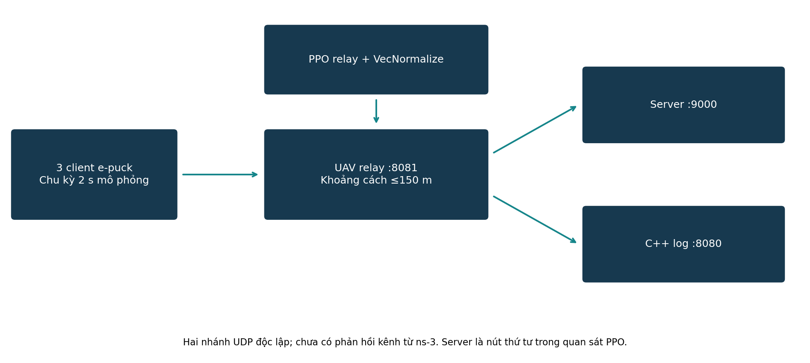
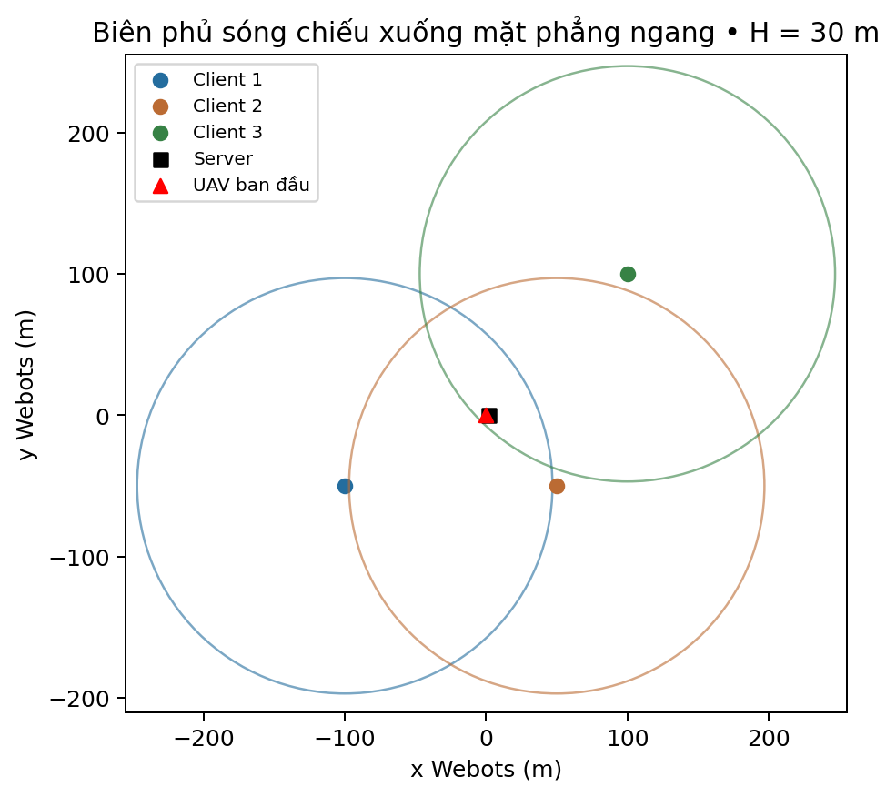
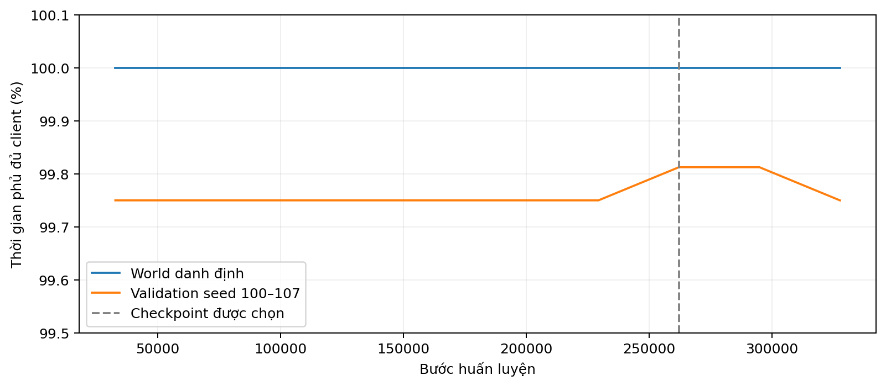
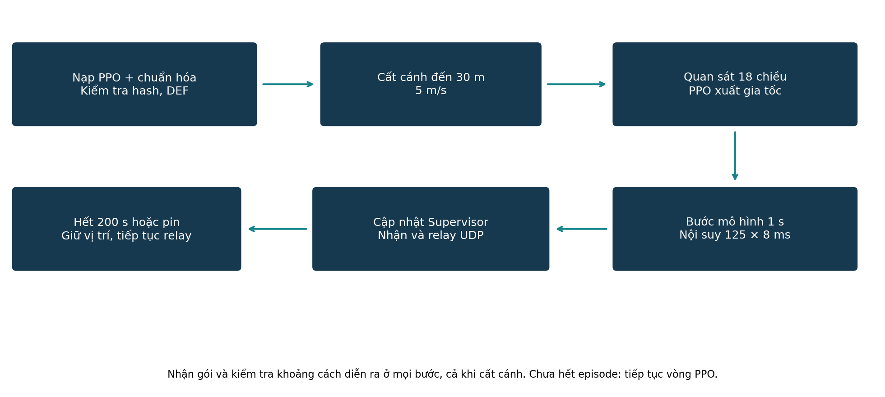
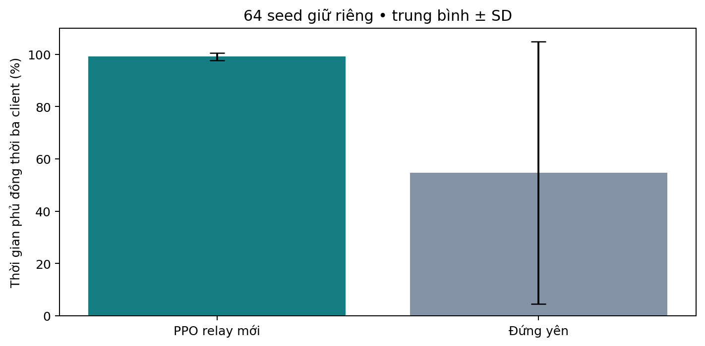
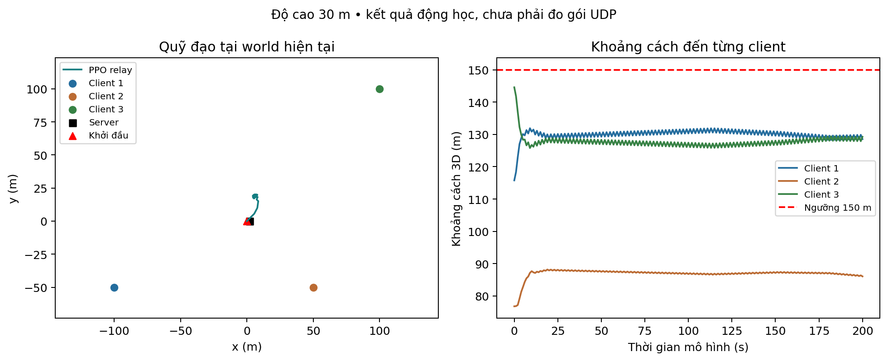
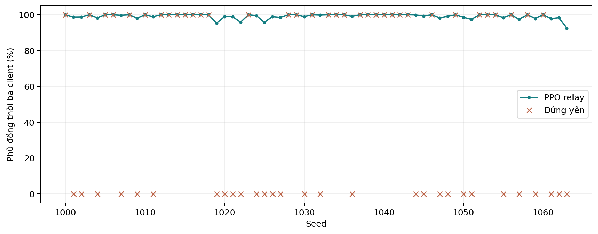

# ĐIỀU HƯỚNG UAV RELAY BẰNG PPO ĐỂ DUY TRÌ VÙNG PHỦ CHO BA E-PUCK

## TÓM TẮT

Đề tài xây dựng UAV relay sử dụng PPO nhằm giữ đồng thời ba e-puck trong vùng liên lạc. Phiên bản hiện tại được huấn luyện mới tại PPO/relay_3epuck, thay vì sử dụng trực tiếp checkpoint UAV-BS tối ưu tốc độ và năng lượng. UAV hoạt động ở độ cao 30 m; mỗi liên kết được xét bằng khoảng cách 3D không vượt 150 m.

Huấn luyện hoàn tất 327.680 bước, chọn checkpoint ở bước 262.144. Trên hình học world hiện tại, cả ba client và server được giữ trong vùng suốt 200 giây đánh giá. Trên 64 seed giữ riêng, tỷ lệ thời gian đồng thời phủ ba client đạt 99,15%, so với 54,69% của baseline đứng yên. Tất cả 64 lượt đạt phủ đầy đủ trong 50 giây cuối. Đây là kết quả mô hình động học và điều kiện khoảng cách, chưa phải PDR hay độ trễ mạng đo trong Webots.

Báo cáo trình bày kiến trúc, mô hình toán học, phần thưởng ưu tiên liên kết, triển khai và đánh giá có đối chứng. Các thông tin hành chính và số liệu chưa đo được giữ trống.

Bản cập nhật này thay thế phần mô tả checkpoint UAV-BS cũ bằng checkpoint relay đã huấn luyện tại PPO/relay_3epuck. Toàn bộ kết luận hiệu năng dưới đây gắn với tập đánh giá của checkpoint mới.

## ĐÓNG GÓP CỦA CÁC THÀNH VIÊN

Các thành viên tự điền và xác nhận thông tin, tổng tỷ lệ phải bằng 100%.

Bảng 1. Đóng góp thành viên

| Họ tên / MSSV | Nhiệm vụ | Tỷ lệ (%) |

| --- | --- | --- |

|  |  |  |

|  |  |  |

|  |  |  |

| Tổng |  |  |

Các thông tin chưa xác nhận được để trống theo yêu cầu.

Bảng 2. Thông tin học phần

| Mục | Thông tin |

| --- | --- |

| Trường / khoa |  |

| Giảng viên |  |

| Nhóm / lớp |  |

| Học phần | PBL3–LTM |

## DANH MỤC KÝ HIỆU

Bảng 3. Ký hiệu sử dụng

| Ký hiệu | Ý nghĩa |

| --- | --- |

| q; uᵢ | Vị trí UAV và nút mặt đất, m |

| H; Rc | Độ cao 30 m; bán kính liên lạc 150 m |

| Cᵢ; C₃; C₄ | Chỉ báo một liên kết, đủ ba client, đủ ba client và server |

| c; a; v | Hành động chuẩn hóa; gia tốc; vận tốc |

| Δt; T | 1 s mỗi bước PPO; 200 bước mỗi episode |

| σᵢ; E | Hiệu suất phổ mô hình; năng lượng còn lại |

| Coverage₃ | Tỷ lệ thời gian cả ba client trong vùng |

| PPO; UDP | Proximal Policy Optimization; User Datagram Protocol |

| SD | Độ lệch chuẩn mẫu |

Kết quả phủ sóng là điều kiện khoảng cách, không đồng nhất với tỷ lệ nhận gói. Ba client và một server tạo bốn node đầu vào; server không phải client thứ tư.

## CHƯƠNG 1. TÍNH CẤP THIẾT VÀ MỤC TIÊU

### 1.1. Bối cảnh

Một UAV có thể làm nút trung gian cho các thiết bị mặt đất phân tán. Chuyển động UAV làm thay đổi khả năng phục vụ từng nút. Nếu chỉ tối ưu tốc độ tổng, chính sách có thể tiến gần một nhóm người dùng và bỏ xa một client khác. Bài toán relay của dự án cần ưu tiên phục vụ đồng thời các nguồn dữ liệu.

### 1.2. Vấn đề và mục tiêu

Checkpoint cũ ở cấu hình 30 m từng làm client 3 ra ngoài bán kính sau khoảng 1,536 giây trong phép kiểm tra quỹ đạo. Từ hiện tượng đó, mục tiêu mới được phát biểu là duy trì vùng phủ đủ ba client, đồng thời xét server như một nút liên kết riêng. Không xem việc nạp được checkpoint là bằng chứng chính sách phù hợp nhiệm vụ.

### 1.3. Đóng góp và phạm vi

Các sản phẩm gồm môi trường relay nhất quán với controller, phần thưởng có xét nút xa nhất, checkpoint và bộ chuẩn hóa mới, đánh giá trên tập seed giữ riêng và tích hợp vào Webots. Phạm vi hiện tại là một UAV, ba client đứng yên, một server, độ cao cố định và mô hình chuyển động động học. Chưa khẳng định hiệu quả trên mạng vô tuyến hoặc đàn UAV.

## CHƯƠNG 2. CƠ SỞ VÀ LỰA CHỌN GIẢI PHÁP

PPO dùng mục tiêu clipped để hạn chế các cập nhật quá lớn thông qua tỷ lệ xác suất chính sách [1]. Hành động liên tục phù hợp với điều khiển gia tốc ngang. Hiệu quả phụ thuộc quan sát và phần thưởng; PPO không tự bảo đảm các liên kết nếu mục tiêu đó chưa được đưa vào môi trường.

MUNILS kết hợp Gazebo, PX4, ROS2 và ns-3 với đồng bộ thời gian và cô lập lưu lượng [2]. Dự án tham khảo yêu cầu tích hợp này nhưng đang dùng Webots. Chương trình C++ trong dự án mới nhận UDP để ghi log, chưa tạo vòng phản hồi kênh vào PPO.

Môi trường UAV-BS ban đầu cung cấp động học, công suất đẩy và mô hình kênh không–đất [3]. Phiên bản relay kế thừa giao diện quan sát nhưng thay đổi giới hạn chuyển động, phân bố khởi tạo và reward. Đây là ứng dụng PPO có sẵn vào bài toán cụ thể; không đề xuất thuật toán PPO mới. Baseline đứng yên là đối chứng đơn giản, cần bổ sung baseline hình học trong các đánh giá tiếp theo.

## CHƯƠNG 3. KIẾN TRÚC VÀ THIẾT KẾ

### 3.1. Thành phần hệ thống

Các client có tọa độ ngang gần (−100, −50), (50, −50), (100, 100) m; server gần (2, 0) m. UAV bắt đầu gần gốc tọa độ và cất cánh đến 30 m. Các DEF đã thống nhất với định danh gói.

Client gửi UDP đến cổng 8081. Relay xét khoảng cách rồi gửi hai bản độc lập tới server cổng 9000 và bộ ghi log cổng 8080. Khoảng cách chặng UAV–server được xét trong môi trường học, nhưng mã chuyển tiếp hiện chưa lọc chặng này theo khoảng cách.

World VD2_vscode sử dụng controller ngoài <extern>. Các DEF client và server đã được thống nhất với sender. Client dùng đồng hồ mô phỏng để phát định kỳ; controller không còn dùng bảng tọa độ dự phòng.

## 3.1. Giao thức và quan sát vận hành

Bảng 4. Gói dữ liệu và nơi xử lý

| Trường / thành phần | Ý nghĩa |

| --- | --- |

| sender; seq | Định danh client và số thứ tự riêng |

| payload | Dữ liệu ứng dụng |

| via_relay; relay_node | Thông tin relay cho cả bộ nhận Python và C++ |

| distance_to_drone | Khoảng cách ghi log, m |

| UDP :8081 | UAV nhận từ ba client |

| UDP :9000 / :8080 | Server / bộ ghi log nhận hai bản gửi độc lập |

Các log IN_RANGE và OUT_OF_RANGE thể hiện khoảng cách. RX_OK, RX_STALE và NO_PACKETS_YET thể hiện việc nhận gói tại relay; ngưỡng stale là 6 giây mô phỏng. Chúng chưa xác nhận server nhận được gói vì chưa có ACK đầu cuối.

Mỗi vòng lặp xử lý tối đa 32 datagram để hạn chế việc hàng đợi gói chiếm thời gian điều khiển. JSON lỗi hoặc sender không thuộc ba client được bỏ qua. Nguồn phát định kỳ 2 giây mô phỏng, giúp thống nhất thang thời gian với chuyển động UAV.

ns-3 vẫn chưa cung cấp phản hồi chất lượng mạng. Bộ C++ chỉ nhận và in gói qua socket hệ điều hành. Các trường PDR, throughput và delay cần được đo riêng khi có phiên chạy Webots đầu cuối.

## CHƯƠNG 4. MÔ HÌNH VÀ PHÁT BIỂU BÀI TOÁN

dᵢ(t) = ||qₜ − uᵢ||₂;   Cᵢ(t) = 1[dᵢ(t) ≤ 150 m].

C₃(t) = ∏ᵢ₌₁³ Cᵢ(t);   C₄(t) = ∏ᵢ₌₁⁴ Cᵢ(t).

C₃ là chỉ báo đủ ba client; C₄ tính thêm server. Ở độ cao H cố định, bán kính đĩa ngang là √(150² − H²). Vùng phục vụ đồng thời là giao các đĩa; điều kiện này không mô tả fading hoặc tranh chấp kênh.

Mục tiêu là tìm chính sách đưa UAV vào vùng giao và duy trì các liên kết trong thời gian hoạt động. Ràng buộc vùng phủ trong môi trường học được biểu diễn bằng phần thưởng, không có bộ ép quỹ đạo về vùng hợp lệ.

## 4.1. Trạng thái, hành động và động học

### 4.1. Trạng thái và hành động

Quan sát 18 chiều chứa vị trí ngang, vận tốc, pin, thời gian, vị trí tương đối bốn node và hiệu suất phổ mô hình. VecNormalize chuẩn hóa quan sát bằng thống kê được lưu cùng checkpoint. Mỗi thành phần action thuộc [−1,1].

aₜ = 2cₜ; v* = vₜ + aₜΔt; vₜ₊₁ = v* min(1,5/||v*||₂).

qxy,ₜ₊₁ = qxy,ₜ + vₜ₊₁Δt; z = 30 m; Δt = 1 s.

Khi v* bằng 0, giữ vận tốc bằng 0. Giới hạn gia tốc 2 m/s² được áp dụng từng trục; giới hạn chuẩn vận tốc là 5 m/s. Vị trí được kẹp trong vùng [0,1000]² và vận tốc theo trục bị vượt biên được đặt về 0.

Bảng 5. Cấu trúc quan sát 18 chiều

| Thành phần | Số chiều |

| --- | --- |

| Vị trí ngang chuẩn hóa | 2 |

| Vận tốc ngang chuẩn hóa | 2 |

| Pin và thời gian còn lại | 2 |

| Vị trí tương đối ba client và server | 8 |

| Hiệu suất phổ mô hình bốn nút | 4 |

## 4.2. Kênh truyền, năng lượng và giả thiết

### 4.2. Mô hình truyền thông

Khoảng cách và góc nâng xác định xác suất LoS và tổn hao trung bình. SNR được chuyển thành hiệu suất phổ σᵢ = log₂(1 + SNRᵢ). Các tham số kế thừa là fc = 2 GHz, Pt = 0,1 W, nhiễu 10⁻¹² W, hệ số LoS 9,61 và 0,16, tổn hao LoS/NLoS 1/20 dB. Mô hình chưa được hiệu chuẩn cho cảnh Webots.

Pin mô hình giảm theo P(||v||)Δt. Hàm công suất cánh quạt kế thừa có công suất treo 168,49 W. Các đại lượng này dùng cho quan sát và kết thúc episode, không phải số đo phần cứng.

Các công thức kênh và năng lượng được kế thừa từ uav_bs_env.py; nguồn huấn luyện của checkpoint relay mới đã được xác định rõ trong PPO/relay_3epuck. Độ cao 100 m và giới hạn 20 m/s của bài toán cũ không còn là cấu hình triển khai hiện tại.

Nút mặt đất đứng yên, không có fading ngẫu nhiên, vật cản riêng lẻ hoặc cạnh tranh MAC trong thực nghiệm này. Các chỉ số kênh được tính giải tích, chưa lấy từ ns-3. Pin khởi đầu 40.000 J và episode tối đa 200 s; giai đoạn cất cánh không tính trong pin mô hình.

## 4.3. Hàm mục tiêu duy trì liên kết

### 4.1. Phần thưởng relay

Đặt bᵢ = max(dᵢ − 150,0)/150, w = maxᵢdᵢ/150 và s = ||v||₂/5. Tổng và trung bình xét cả ba client cùng server.

r = 3C₄ + mean(Cᵢ) − 3w − 12Σᵢbᵢ − 0,3s² − 0,03mean(c²).

Khi hết pin trừ thêm 5. Thưởng đủ liên kết và phạt vượt ngưỡng tạo động lực phục hồi; thành phần khoảng cách xa nhất tăng khoảng dự phòng. Phạt tốc độ và hành động hạn chế dao động. Đây là ràng buộc mềm, không bảo đảm tuyệt đối trên mọi trạng thái.

Bộ hệ số phần thưởng được cố định trong lượt huấn luyện này. Chưa có khảo sát loại bỏ từng thành phần hoặc tối ưu các trọng số. Do đó chưa thể quy toàn bộ cải thiện cho riêng một thành phần reward.

## CHƯƠNG 5. HUẤN LUYỆN VÀ TRIỂN KHAI PPO

### 4.2. Huấn luyện PPO

Lclip(θ) = E[min(ρₜÂₜ, clip(ρₜ,1−ε,1+ε)Âₜ)].

ρₜ là tỷ lệ xác suất giữa chính sách mới và cũ, Âₜ là lợi thế [1]. Huấn luyện mới từ đầu với tám môi trường song song, seed 42, 327.680 bước. Chọn checkpoint ở bước 262.144 bằng kịch bản cố định và seed validation 100–107, trước khi đánh giá tập giữ riêng.

Bảng 6. Cấu hình PPO

| Thông số | Giá trị |

| --- | --- |

| Mạng ẩn | [64,64] |

| n_steps / batch / n_epochs | 256 / 256 / 5 |

| learning_rate / gamma | 0,0003 / 0,99 |

| GAE λ / clip / entropy | 0,95 / 0,2 / 0,005 |

| vmax / amax / H | 5 m/s / 2 m/s² mỗi trục / 30 m |

Nút mặt đất được nhiễu xy đều ±5 m. UAV khởi tạo lệch quanh vị trí danh định trong ±25 m với xác suất 85%, hoặc ±70 m với xác suất 15%. Mỗi 32.768 bước tiến hành validation; điểm chọn ưu tiên phủ đủ ở hình học cố định, sau đó tỷ lệ phủ trung bình và khoảng cách client xa nhất.

## 5.1. Tiến trình huấn luyện và lựa chọn checkpoint

PPO mới được huấn luyện từ đầu với seed 42, tám môi trường và mạng [64,64]. Tổng số chuyển trạng thái là 327.680; checkpoint được chọn ở bước 262.144. Tập validation gồm kịch bản danh định và seed 100–107. Tập seed 1000–1063 chỉ được dùng sau khi đã chọn checkpoint.

Mô hình và VecNormalize được lưu cùng nhau ở mỗi checkpoint tốt hơn. Controller kiểm tra SHA-256 và contract relay_3epuck_v1 để ngăn ghép nhầm bộ chuẩn hóa hoặc môi trường. Các tệp cũ được giữ để đối chiếu nhưng không được controller dùng làm chính sách hiện hành.

## 5.2. Tích hợp controller và lưu đồ

### 4.3. Tích hợp

Controller nạp checkpoint và bộ chuẩn hóa mới, xác nhận contract cùng hash. Sau cất cánh, mỗi giây PPO xuất gia tốc; chuyển trạng thái được nội suy thành 125 bước Webots 8 ms. Không có bộ ép quỹ đạo hay chính sách dự phòng thay hành động PPO.

Supervisor ghi trực tiếp vị trí và resetPhysics. Khi episode kết thúc, UAV giữ tọa độ cuối và tiếp tục relay. Đây là điều khiển động học; chưa phải điều khiển lực đẩy hoặc kiểm chứng va chạm.

## 5.3. Cấu hình triển khai và kiểm tra thành phần

Bảng 7. Thành phần hiện tại

| Tệp / cấu hình | Vai trò |

| --- | --- |

| ppo_relay_3epuck.zip | Checkpoint relay được chọn |

| vecnorm_relay_3epuck.pkl | Thống kê chuẩn hóa của cùng lượt học |

| relay_env.py / relay_model.json | Môi trường chung và metadata/hash |

| ppo_bridge.py | Xây dựng quan sát, suy luận, chuyển trạng thái |

| dieukhien.py | Supervisor, nội suy và chuyển tiếp UDP |

| VD2_vscode.wbt / VD2.wbt | Controller ngoài / controller nội bộ |

12 kiểm tra đã đạt gồm nạp mô hình, gia tốc và giới hạn vận tốc, biên không gian, kết thúc episode, cất cánh, chu kỳ một giây, lịch client dùng thời gian mô phỏng, xử lý JSON lỗi, phân loại log và giữ cả ba client trong vùng trên toàn bộ quỹ đạo 200 giây.

Các kiểm tra vòng lặp dùng đối tượng Webots/socket giả lập. Do chưa khởi chạy được giao diện Webots trong môi trường thực hiện, kết quả này không thay thế kiểm chứng UDP thực hoặc chuyển động vật lý.

## CHƯƠNG 6. THIẾT KẾ THỰC NGHIỆM

Thử nghiệm cố định dùng tọa độ đọc từ world VD2_vscode, gồm cả sai số nhỏ khi lưu world. Đánh giá mở rộng dùng seed 1000–1063, không dùng để chọn checkpoint. PPO và baseline đứng yên có cùng trạng thái đầu cho từng seed.

Coverage₃ = (1/N) Σⱼ C₃(tⱼ);   tⱼ cách nhau 0,008 s.

Mỗi lượt kéo dài 200 giây với 25.000 vị trí nội suy. Ghi nhận tỷ lệ phủ đồng thời ba client, tỷ lệ trong 50 giây cuối, khoảng cách lớn nhất và thời điểm phục hồi rồi duy trì đến hết lượt. Thời điểm phục hồi xét tại mốc giây nguyên.

Baseline đứng yên giữ vị trí đầu. Nếu đã phủ đủ thì baseline cũng đạt 100%; nếu ngoài vùng thì không tự phục hồi. Vì vậy so sánh trên tập vị trí nhiễu phù hợp hơn chỉ xem lượt danh định. Dữ liệu và cấu hình được lưu để tái lập. Chưa có số đo throughput/PDR/độ trễ đầu cuối.

## 6.1. Kết quả định lượng

Bảng 8. Kết quả đánh giá

| Chỉ số | PPO mới | Đứng yên |

| --- | --- | --- |

| World hiện tại, 200 s | 100% | 100% theo hình học |

| 64 seed: phủ đồng thời TB | 99,15% | 54,69% |

| 50 giây cuối | 100% ở 64/64 lượt | 100% ở 35/64 lượt |

| Khởi tạo đã phủ đủ | 35/64 lượt | Cùng trạng thái đầu |

Ở world hiện tại cả ba client và server nằm trong vùng suốt lượt đánh giá. Khoảng cách client lớn nhất tính cả vị trí đầu là 144,56 m. Năng lượng mô hình dùng trong lượt này là 33.105,02 J; chưa phải phép đo pin thực.

## 6.2. Quỹ đạo và khoảng cách liên kết

UAV tiến vào vị trí cân bằng hơn giữa các client xa nhất. Quỹ đạo vẫn còn dao động nhỏ, song không vượt ngưỡng trong lượt danh định. Không dùng bộ giữ tọa độ thay PPO để tạo số liệu này.

## 6.3. Đánh giá theo từng kịch bản

Trung bình tỷ lệ phủ trên 64 seed là 99,1515625%, cao hơn baseline 44,46 điểm phần trăm. Cả 64 lượt phủ đủ trong 50 giây cuối. Phục hồi rồi duy trì ổn định cần tối đa 16 giây theo mốc giây ở tập đã thử.

Có 35/64 kịch bản khởi tạo trong vùng phủ đủ ba client. Baseline đứng yên duy trì nguyên trạng, còn PPO có thể phục hồi các trường hợp bắt đầu ngoài vùng. Vì vậy cần nêu trạng thái đầu khi diễn giải lợi ích, không chỉ báo cáo trung bình.

Tất cả 64 lượt giữ đầy đủ ba client trong 50 giây cuối. Mốc phục hồi rồi duy trì ổn định tối đa là 16 giây theo phép kiểm tra mốc giây nguyên. Kết quả chưa chứng minh điều tương tự cho các vị trí ngoài phân bố ngẫu nhiên đã dùng.

## 6.4. Phân tích độ phức tạp và khả năng tái lập

Với K nút, một bước tính quan sát và kênh có chi phí O(K). Actor hai lớp ẩn h có chi phí O(dh+h²+2h), với d = 6+3K. Đánh giá M lượt dài T có chi phí O(MT(K+dh+h²)), chưa tính lấy mẫu nội suy và I/O.

K = 4 nút gồm ba client và server, d = 18 và h = 64. Actor có khoảng 5.376 phép nhân–cộng qua các lớp tuyến tính, chưa gồm bias, kích hoạt và xử lý phân phối. Đây là số học từ kiến trúc; chưa có phép đo mới về thời gian suy luận hoặc RAM cực đại của checkpoint relay để đưa vào bảng kết quả.

Mỗi rollout 200 bước được đánh giá tại 125 vị trí nội suy mỗi bước. Dữ liệu gốc gồm evaluation_rollouts.json, evaluation.json, config.json, best_validation.json và progress.jsonl. Tất cả được sao vào minh_chung/relay_3epuck của báo cáo để gắn biểu đồ với kết quả cụ thể.

Trình tự tái lập là tạo môi trường relay, huấn luyện với cấu hình cố định, chọn checkpoint trên validation, đánh giá seed giữ riêng rồi xuất hình. Không trộn số liệu 30 seed của checkpoint UAV-BS cũ vào tập kết quả 64 seed hiện tại.

## 6.5. Thảo luận, hạn chế và số liệu chưa có

Kết quả cho thấy phần thưởng gắn với đầy đủ liên kết cải thiện khả năng phục hồi so với đứng yên. Đây là bằng chứng trong tập kịch bản đã khảo sát, không phải chứng minh ràng buộc cứng cho mọi vị trí.

Tập giữ riêng cùng họ phân bố với huấn luyện: độ lệch nút nhỏ, độ cao cố định, nút không di chuyển. Chỉ có một seed huấn luyện nên chưa định lượng biến thiên giữa các lần học độc lập.

Phủ sóng hình học không bảo đảm gói UDP đến đích. Socket, controller, đồng bộ và hàng đợi có thể ảnh hưởng kết quả. Log nhận tại relay chưa là ACK từ server. Mô phỏng mạng ns-3 chưa tham gia vòng điều khiển.

Cần bổ sung baseline tối ưu hình học, khảo sát reward, nhiều seed huấn luyện và số đo Webots đầu cuối. Mở rộng client di chuyển hoặc nhiều UAV cần đánh giá riêng.

Bảng 9. Số liệu chưa xác nhận

| Nội dung | Kết quả |

| --- | --- |

| PDR đo tại server |  |

| Throughput UDP đầu cuối |  |

| Độ trễ đầu cuối |  |

| Ảnh hưởng vật cản qua ns-3 |  |

| Thời gian suy luận / RAM checkpoint relay mới |  |

| Nhiều seed huấn luyện độc lập |  |

## CHƯƠNG 7. KẾT LUẬN VÀ HƯỚNG PHÁT TRIỂN

Đã huấn luyện và tích hợp chính sách PPO riêng cho ba e-puck ở độ cao 30 m. Checkpoint mới giữ đủ vùng phủ trong 200 giây ở world hiện tại, đạt trung bình 99,15% trên 64 seed giữ riêng và phục hồi các trạng thái mà đứng yên không khắc phục được. Kết luận giới hạn ở mô hình động học cùng điều kiện khoảng cách; chưa chứng minh hiệu năng truyền thông thực hoặc khả năng bay vật lý.

Bảng 10. Mức độ hoàn thành

| Mục tiêu | Hiện trạng |

| --- | --- |

| Huấn luyện PPO cho ba e-puck | Hoàn tất, có mã và log xác định |

| Tích hợp đúng quan sát và hành động | Đã cập nhật controller và kiểm tra ngoại tuyến |

| Giữ vùng phủ 200 giây ở world hiện tại | Đạt trong mô hình động học |

| Đo gói đầu cuối Webots | Chưa có số liệu xác nhận |

| Phản hồi mạng ns-3 | Chưa tích hợp đầy đủ |

Ưu tiên tiếp theo là chạy và ghi log đầu cuối trong Webots, bổ sung baseline hình học, đánh giá nhiều seed huấn luyện và khảo sát các thành phần reward. Khi đã có bằng chứng mạng và động lực học, mới đánh giá khả năng mở rộng sang client di chuyển hoặc nhiều UAV.

## TÀI LIỆU THAM KHẢO

[1] Schulman và cộng sự. Proximal Policy Optimization Algorithms. arXiv:1707.06347v2, 2017. PDF trong Tailieu.

[2] Lee và cộng sự. MUNILS: A Time-Synchronized and Traffic-Isolated Multi-UAV Simulation Platform Based on Integrated Physical and Network Simulators. Drones 10, 387, 2026. DOI:10.3390/drones10050387.

[3] Mã PPO/uav_bs_ppo.py và uav_bs_env.py: động học, kênh và năng lượng kế thừa.

[4] PBL3-LTM: dieukhien.py, ppo_bridge.py, relay_env.py, controller e-puck và VD2_vscode.wbt sau tích hợp.

[5] PPO/relay_3epuck: train.py, evaluate.py; run_01/config.json, progress.jsonl, best_validation.json, evaluation.json, evaluation_rollouts.json. Nguồn kết quả huấn luyện mới.

[6] BaoCaoCK_TieuChiDanhGia.pdf trong Downloads. Tiêu chí học phần: tối đa 100 trang A4, không chèn mã nguồn, đánh giá tám nhóm nội dung tổng 100 điểm.

## PHỤ LỤC. ĐỐI CHIẾU TIÊU CHÍ

Bảng 11. Đối chiếu yêu cầu báo cáo

| Tiêu chí / trọng số | Vị trí |

| --- | --- |

| Đóng góp — 5% | Phần thông tin nhóm, để trống chờ xác nhận |

| Tính cấp thiết — 10% | Chương 1 |

| Kiến trúc — 15% | Chương 3 và các sơ đồ |

| Toán học — 15% | Chương 4 |

| Triển khai, giải thuật — 20% | Chương 5 |

| Hiệu năng — 25% | Chương 6, 64 seed giữ riêng và baseline |

| Kết luận — 5% | Chương 7 |

| Chất lượng trình bày — 5% | Mục lục, hình, bảng, trích dẫn, nguồn số liệu |

Các ô hành chính và đóng góp chưa biết được để trống. Tỷ lệ đóng góp cần được thành viên thống nhất với tổng 100%. Kết quả chưa đo không được thay bằng số liệu mô phỏng khác.

Bản này cập nhật trực tiếp báo cáo cũ theo checkpoint relay mới. Bản trước cập nhật được lưu trong luu_tru_truoc_cap_nhat_PPO; các kết luận về đầu vào chỉ có ba giá trị, thiếu DEF hoặc controller <none> không còn được mô tả là hiện trạng.