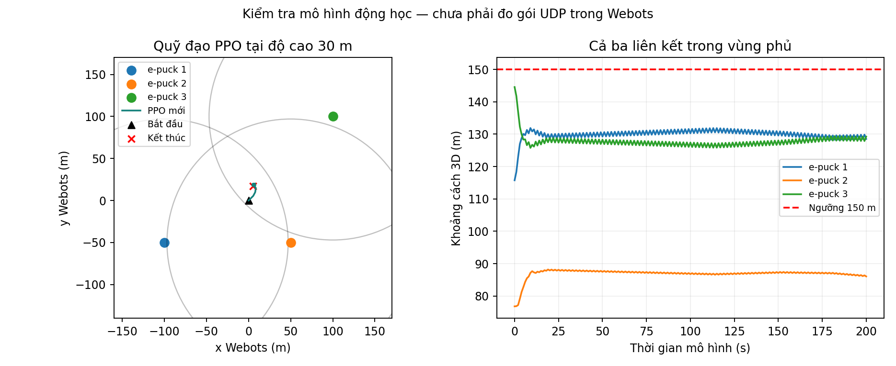

# Điều khiển UAV relay bằng PPO để duy trì vùng phủ cho ba nút e-puck

## Tóm tắt

Nghiên cứu này xây dựng và đánh giá chính sách Proximal Policy Optimization (PPO) nhằm duy trì một UAV trong vùng có thể phục vụ đồng thời ba nút mặt đất. Khác biệt giữa mục tiêu tối ưu tốc độ dữ liệu và yêu cầu duy trì đầy đủ liên kết được xử lý bằng phần thưởng có xét nút xa nhất, trạng thái phủ sóng và chi phí chuyển động. Một môi trường động học ở độ cao 30 m được sử dụng để huấn luyện mới 327.680 bước; chính sách được tích hợp vào nguyên mẫu Webots qua bộ điều khiển Supervisor và luồng chuyển tiếp UDP. Trên tọa độ world hiện tại, cả ba client và server nằm trong bán kính 150 m suốt 200 giây đánh giá. Trên 64 kịch bản giữ riêng với vị trí ngẫu nhiên, tỷ lệ thời gian phủ đồng thời ba client đạt 99,15%, so với 54,69% khi UAV đứng yên. Toàn bộ 64 kịch bản duy trì đủ ba client trong 50 giây cuối. Kết quả phản ánh điều kiện khoảng cách của mô hình động học; chưa xác nhận tỷ lệ nhận gói hoặc độ trễ đầu cuối trong Webots/ns-3. Những giới hạn về mô hình truyền thông, trạng thái khởi tạo và chuyển giao chính sách được thảo luận.

Từ khóa: UAV relay; PPO; học tăng cường; vùng phủ đồng thời; Webots; UDP.

## Abstract

This study develops a PPO policy for maintaining simultaneous geometric coverage of three ground clients by a UAV relay. The reward accounts for worst-link distance, coverage violations, and motion costs. A new policy is trained for 327,680 transitions at a fixed altitude of 30 m and integrated into a Webots Supervisor controller. All three clients and the server remain within a 150 m radius throughout a 200 s rollout on the current world geometry. Across 64 held-out randomized scenarios, simultaneous three-client coverage averages 99.15%, compared with 54.69% for hovering. All scenarios achieve full coverage during the final 50 s. These results describe kinematic and distance-based coverage rather than measured packet delivery or end-to-end network latency.

## 1. Giới thiệu

UAV có thể đóng vai trò nút chuyển tiếp khi các thiết bị mặt đất phân bố rải rác. Vị trí UAV ảnh hưởng đến khoảng cách tới từng nút và khả năng phục vụ đồng thời nhiều nguồn dữ liệu. Một chính sách đạt tốc độ tổng cao vẫn có thể rời xa một người dùng yếu, nên mục tiêu tối ưu truyền thông cần được phát biểu phù hợp với yêu cầu của ứng dụng.

Dự án PBL3-LTM có nguyên mẫu một UAV, ba client e-puck và một server. Client phát gói UDP, UAV quyết định chuyển tiếp dựa trên ngưỡng khoảng cách. Checkpoint UAV-BS trước đây ưu tiên tốc độ dữ liệu, công bằng và năng lượng trong một môi trường khác. Khi áp dụng ở độ cao 30 m với bộ chuyển đổi trước lần huấn luyện mới, kiểm tra quỹ đạo ghi nhận client 3 ra ngoài vùng sau khoảng 1,536 s. Quan sát này gợi ý rằng tương thích về kích thước đầu vào chưa đủ để đáp ứng mục tiêu relay [4].

Nghiên cứu đặt câu hỏi: một chính sách PPO được huấn luyện trực tiếp với mục tiêu giữ đầy đủ vùng phủ có thể duy trì cả ba client trong ngưỡng liên lạc hay không, và khả năng đó thay đổi như thế nào khi vị trí ban đầu bị lệch? Đóng góp gồm một đặc tả môi trường relay gắn với world hiện có, một phần thưởng ưu tiên liên kết yếu nhất, bộ tích hợp nhất quán giữa huấn luyện và điều khiển, cùng đánh giá đối chứng trên các kịch bản giữ riêng.

Phạm vi của bài là một UAV ở độ cao cố định, các nút mặt đất đứng yên và mô hình phủ sóng hình học. Không đề xuất biến thể PPO mới. Tính hữu ích được xem xét qua khả năng giữ vùng phủ và tính tái lập của tích hợp, thay vì tuyên bố về mạng vô tuyến thực.

## 2. Cơ sở và công trình liên quan

PPO sử dụng mục tiêu clipped nhằm hạn chế các cập nhật chính sách quá lớn thông qua tỷ lệ xác suất hành động giữa chính sách mới và cũ [1]. Giao diện hành động liên tục phù hợp với việc xuất gia tốc ngang. Tuy nhiên, hiệu quả phụ thuộc vào phần thưởng, phân bố trạng thái và ngữ nghĩa của quan sát; thuật toán không tự bảo đảm các ràng buộc liên kết nếu chúng không được đưa vào bài toán.

MUNILS tích hợp Gazebo, PX4, ROS2 và ns-3, nhấn mạnh đồng bộ thời gian cùng cô lập lưu lượng giữa mô phỏng vật lý và mô phỏng mạng [2]. Nghiên cứu hiện tại tham khảo yêu cầu tích hợp đó nhưng triển khai trên Webots. Thành phần C++ trong dự án hiện nhận UDP để ghi log; chưa có topology vô tuyến và phản hồi chất lượng mạng vào chính sách.

Môi trường UAV-BS ban đầu trong thư mục PPO cung cấp động học, mô hình kênh không–đất và năng lượng [3]. Nghiên cứu kế thừa các phép tính này để duy trì giao diện 18 chiều, đồng thời thay đổi phân bố khởi tạo, giới hạn chuyển động và phần thưởng cho nhiệm vụ relay. Baseline đứng yên được chọn vì dễ tái lập và làm rõ lợi ích của việc dịch chuyển khi vị trí ban đầu không phủ đủ client.

## 3. Mô hình hệ thống và phát biểu bài toán

### 3.1. Hình học và luồng truyền thông

Ba client có tọa độ ngang xấp xỉ (−100, −50), (50, −50) và (100, 100) m. Server ở gần (2, 0) m. UAV bắt đầu gần (0, 0), cất cánh theo kịch bản lên H = 30 m rồi giao chuyển động ngang cho PPO. Controller lấy tọa độ thực qua DEF/Supervisor và dịch xy thêm 500 m để dùng hệ tọa độ mô hình [0, 1000]².

Client phát gói ngay lần đầu, sau đó mỗi 2 giây mô phỏng tới cổng 8081. UAV nhận JSON gồm sender, seq và payload, tính khoảng cách rồi gửi tới server cổng 9000 và bộ ghi log cổng 8080. Hai bản gửi là độc lập. Ngưỡng chuyển tiếp được kiểm tra cho chặng client–UAV; server cũng được xét trong phần thưởng và đánh giá hình học nhưng mã relay chưa có bộ lọc khoảng cách chặng UAV–server [4].

dᵢ(t) = ||qₜ − uᵢ||₂;   Cᵢ(t) = 1[dᵢ(t) ≤ Rc],   Rc = 150 m.

Call,3(t) = ∏ᵢ₌₁³ Cᵢ(t);   Call,4(t) = ∏ᵢ₌₁⁴ Cᵢ(t).

Trong các phần tiếp theo, viết gọn C₃ = Call,3 và C₄ = Call,4: C₃ biểu thị cả ba client cùng trong vùng; C₄ bao gồm thêm server. Điều kiện này là đặc tả vùng phủ xác định, không phải xác suất nhận gói. Tập vị trí thỏa cả bốn liên kết là giao các đĩa ngang có bán kính √(Rc² − H²).

### 3.2. Trạng thái, hành động và động học

Quan sát có 18 chiều: vị trí ngang chuẩn hóa (2), vận tốc ngang (2), pin và thời gian còn lại (2), tọa độ tương đối của ba client cùng server (8), hiệu suất phổ mô hình của bốn nút (4). Quan sát được tiếp tục chuẩn hóa bằng VecNormalize. Hành động cₜ có hai thành phần trong [−1, 1], được diễn giải thành gia tốc.

aₜ = 2cₜ;   v* = vₜ + aₜΔt;   vₜ₊₁ = v* min(1, 5/||v*||₂).

qxy,ₜ₊₁ = qxy,ₜ + vₜ₊₁Δt;   zₜ = 30 m;   Δt = 1 s.

Khi v* bằng 0, vận tốc giữ bằng 0. Vận tốc tối đa là 5 m/s; giới hạn gia tốc 2 m/s² được áp dụng riêng từng trục. Vị trí vượt biên được kẹp và thành phần vận tốc tương ứng về 0. Episode kết thúc sau 200 bước hoặc khi pin mô hình cạn. Cất cánh không nằm trong episode học.

### 3.3. Các đại lượng kênh và năng lượng

Hiệu suất phổ trong quan sát được tính từ mô hình khoảng cách và góc nâng: xác suất LoS điều chỉnh tổn hao trung bình, sau đó chuyển tổn hao dB thành SNR và tính σᵢ = log₂(1 + SNRᵢ). Các tham số kế thừa là tần số 2 GHz, công suất 0,1 W, nhiễu 10⁻¹² W, hệ số LoS 9,61 và 0,16, tổn hao bổ sung LoS/NLoS 1/20 dB [3]. Các giá trị chưa được hiệu chuẩn cho cảnh Webots.

Năng lượng cập nhật theo Eₜ₊₁ = Eₜ − P(||vₜ₊₁||₂)Δt, với E₀ = 40.000 J. Hàm công suất cánh quạt kế thừa từ môi trường UAV-BS có P(0) = 168,49 W. Phần thưởng mới không trực tiếp tối đa hóa tốc độ dữ liệu; mô hình kênh vẫn cung cấp quan sát và năng lượng vẫn quyết định điều kiện kết thúc.

## 4. Phương pháp đề xuất

### 4.1. Phần thưởng ưu tiên đầy đủ liên kết

Đặt bᵢ = max(dᵢ − Rc, 0)/Rc, w = maxᵢ(dᵢ)/Rc và s = ||v||₂/5. Chỉ số i chạy trên ba client cùng server. Phần thưởng triển khai là:

rₜ = 3C₄ + mean(Cᵢ) − 3w − 12Σᵢbᵢ − 0,3s² − 0,03mean(cₜ²).

Nếu hết pin, phần thưởng trừ thêm 5. Thành phần 3C₄ thưởng việc duy trì đầy đủ các liên kết. Phạt vượt bán kính tăng theo độ vượt, tạo tín hiệu phục hồi khi UAV ở ngoài vùng; thành phần nút xa nhất khuyến khích khoảng cách dự phòng thay vì chỉ đứng sát biên. Phạt vận tốc và hành động hạn chế chuyển động dư thừa. Đây là ràng buộc mềm thông qua phần thưởng, không phải một bảo đảm toán học giữ kết nối mọi lúc.

### 4.2. Huấn luyện PPO

Lclip(θ) = E[min(ρₜÂₜ, clip(ρₜ, 1 − ε, 1 + ε)Âₜ)].

ρₜ là tỷ lệ xác suất hành động của chính sách mới so với cũ và Âₜ là ước lượng lợi thế [1]. Chính sách được huấn luyện mới từ đầu, không tinh chỉnh checkpoint cũ. Tám môi trường song song thu thập rollout, chuẩn hóa quan sát/phần thưởng và cập nhật mạng actor–critic.

Bảng 1. Cấu hình huấn luyện và đánh giá

| Thông số | Giá trị |

| --- | --- |

| Mạng / seed | Hai lớp ẩn [64, 64] / 42 |

| Bước huấn luyện / checkpoint chọn | 327.680 / 262.144 |

| n_envs / n_steps / batch_size | 8 / 256 / 256 |

| n_epochs / learning_rate | 5 / 0,0003 |

| γ / GAE λ / clip ε | 0,99 / 0,95 / 0,2 |

| Hệ số entropy | 0,005 |

| Thiết bị | CPU, một luồng PyTorch |

| Độ cao / bán kính / thời lượng | 30 m / 150 m / 200 s |

Tọa độ ngang của mỗi nút được nhiễu đều ±5 m. UAV khởi tạo quanh vị trí danh định với biên ±25 m trong 85% trường hợp và ±70 m trong 15% còn lại. Phân bố này tạo cả trường hợp đã phủ đủ và trường hợp cần phục hồi. Mỗi 32.768 bước, mô hình được đánh giá trên kịch bản cố định cùng các seed 100–107. Điểm chọn là 100 lần tỷ lệ phủ của kịch bản cố định, cộng 10 lần tỷ lệ phủ trung bình validation, trừ 0,01 lần khoảng cách client lớn nhất của kịch bản cố định. Checkpoint tại bước 262.144 được chọn trước khi mở tập đánh giá giữ riêng.

### 4.3. Tích hợp vào Webots

Controller nạp checkpoint relay và bộ chuẩn hóa tương ứng, kiểm tra contract cùng SHA-256 của các tệp. Sau khi đạt 30 m, PPO dự đoán gia tốc mỗi giây. Chuyển trạng thái 1 s được nội suy qua 125 bước Webots 8 ms; vị trí được ghi bằng Supervisor và resetPhysics. Các node, thứ tự quan sát và phép đổi tọa độ thống nhất với môi trường học.

Không dùng bộ ép quỹ đạo vào vùng phủ hoặc hành động thay thế để tạo kết quả đánh giá. Khi episode kết thúc, UAV giữ vị trí cuối và tiếp tục xử lý relay. Cơ chế này là mô phỏng động học; chưa thể hiện bộ điều khiển lực đẩy, va chạm hoặc tiêu thụ pin thực.

## 5. Thiết kế thực nghiệm

Thực nghiệm thứ nhất sử dụng tọa độ đọc từ world VD2_vscode hiện có, bao gồm sai số tọa độ nhỏ do lưu world. Thực nghiệm thứ hai dùng 64 seed 1000–1063, không dùng để chọn checkpoint. PPO và baseline đứng yên nhận cùng trạng thái ban đầu ở từng seed. Các nút không di chuyển trong một episode; tính ngẫu nhiên nằm ở hình học ban đầu.

Coverage₃ = (1/N)Σⱼ C₃(tⱼ),   tⱼ cách nhau 0,008 s.

Mỗi episode có 25.000 vị trí nội suy. Chỉ số chính là tỷ lệ thời gian cả ba client đồng thời trong vùng. Các chỉ số bổ sung gồm vùng phủ cả bốn nút, tỷ lệ trong 50 giây cuối, khoảng cách client lớn nhất và thời điểm phục hồi rồi duy trì đến hết episode. Thời điểm phục hồi được kiểm tra theo mốc giây nguyên; không phải phép đo trễ mạng.

Baseline giữ UAV tại vị trí khởi đầu. Đây là đối chứng đơn giản; với kịch bản danh định đã nằm trong vùng, đứng yên cũng có thể đạt phủ sóng đầy đủ. Lợi ích của học chính sách cần được đánh giá rõ hơn ở tập vị trí nhiễu, nhất là các trạng thái bắt đầu ngoài vùng. Chưa thực hiện đối chứng với bộ điều khiển hình học tối ưu tâm vùng hoặc thuật toán học khác.

Dữ liệu mỗi lượt, cấu hình và tiến trình được lưu trong thư mục run_01 của bài huấn luyện relay [5]. Số liệu mô hình cũ từ báo cáo trước không được gộp vào tập kết quả mới vì mục tiêu, động học và điều kiện khởi tạo khác nhau.

## 6. Kết quả

Bảng 2. Kết quả giữ đồng thời ba client trong vùng

| Kịch bản / chỉ số | PPO mới | Đứng yên |

| --- | --- | --- |

| World hiện tại, 200 s | 100% | 100% theo hình học cố định |

| 64 seed: trung bình | 99,15% | 54,69% |

| 64 seed: SD mẫu | 1,42% | 50,17% |

| 64 seed: 50 giây cuối | 100% ở 64/64 lượt | 100% ở 35/64 lượt |

| Đã phủ đủ lúc khởi đầu | 35/64 lượt | Cùng trạng thái đầu |

Trên kịch bản cố định, cả ba client và server đều trong vùng suốt 200 s. Khoảng cách client lớn nhất, tính cả vị trí đầu, là 144,56 m, nhỏ hơn ngưỡng 150 m. Năng lượng mô hình cho lượt này là 33.105,02 J. Các số liệu phản ánh đường đi dưới mô hình đã mô tả, không phải phép đo pin hoặc thông lượng UDP.

Trên 64 seed giữ riêng, trung bình thời gian phủ đồng thời ba client đạt 99,1515625%. Baseline đạt 54,6875%, tương ứng 35/64 lượt bắt đầu trong vùng rồi đứng yên. Mức chênh lệch là 44,46 điểm phần trăm. Cả 64 lượt PPO đạt phủ đầy đủ trong 50 giây cuối; thời gian phục hồi rồi duy trì ổn định tối đa được ghi nhận là 16 s theo mốc giây.

Đường khoảng cách cho thấy chính sách dịch chuyển UAV về vị trí cân bằng hơn giữa hai client xa nhất. Sau giai đoạn đầu, vẫn có dao động nhỏ của quỹ đạo; đây là hành vi còn lại của chính sách, không bị che bằng một bộ giữ vị trí thay thế. Các dao động trong lượt danh định không làm mất vùng phủ.

Bộ kiểm tra controller gồm 12 trường hợp đã đạt, trong đó có nạp checkpoint, ngữ nghĩa gia tốc, giới hạn chuyển động, lịch phát gói theo thời gian mô phỏng, xử lý gói lỗi và quỹ đạo đủ 200 s. Kiểm tra vòng lặp sử dụng đối tượng Webots/socket giả lập nên chưa xác nhận hoạt động đầu cuối trên giao diện Webots.

## 7. Thảo luận và giới hạn

Kết quả ủng hộ việc điều chỉnh mục tiêu học cho đúng yêu cầu ứng dụng. Khi phần thưởng trực tiếp xét nút xa nhất và mất vùng phủ, chính sách có thể phục hồi các trạng thái mà đứng yên không giải quyết được. Tuy nhiên, checkpoint chưa có bảo đảm ràng buộc cứng; kết quả 100% trên một tập hữu hạn không có nghĩa mọi quỹ đạo tương lai đều giữ đầy đủ liên kết.

Tập giữ riêng được lấy từ cùng họ phân bố với huấn luyện: độ lệch nút nhỏ, độ cao cố định và ba client đứng yên. Đây là kiểm tra khái quát trong phân bố. Chưa đánh giá client di chuyển, topology khác xa, nhiễu đo vị trí, mất phản hồi hoặc độ cao khác. Chỉ có một seed huấn luyện nên chưa định lượng độ biến thiên giữa các lần huấn luyện độc lập.

Vùng phủ hình học chưa tương đương liên lạc mạng. Gói có thể không đến đích dù khoảng cách nhỏ nếu controller không chạy, socket lỗi hoặc tiến trình bị chậm. Các log IN_RANGE, OUT_OF_RANGE, RX_OK, RX_STALE và NO_PACKETS_YET giúp phân biệt điều kiện hình học với việc nhận tại relay, nhưng chưa thay thế ACK tại server. PDR, throughput và độ trễ đầu cuối hiện chưa có số đo xác nhận.

Với K nút và mạng hai lớp ẩn h, một bước tính quan sát/kênh có chi phí O(K), còn các lớp tuyến tính actor có chi phí O(dh + h² + 2h), d = 6 + 3K. Đánh giá M episode dài T có chi phí O(MT(K + dh + h²)), ngoài chi phí lấy mẫu quỹ đạo. Chi phí suy luận thấp không tự chứng minh khả năng thời gian thực vì chưa tính Webots, log và I/O mạng.

Hướng hoàn thiện trước mắt là đo đầu cuối trên Webots, thêm baseline hình học, khảo sát nhiều seed huấn luyện và tách ảnh hưởng từng thành phần reward. Sau đó có thể bổ sung phản hồi ns-3 và kiểm tra chuyển động vật lý. Việc mở rộng nhiều UAV cần được nghiên cứu riêng thay vì suy từ kết quả một relay.

## 8. Kết luận

Nghiên cứu xây dựng chính sách PPO riêng cho nhiệm vụ giữ vùng phủ của ba e-puck và tích hợp vào controller Webots ở độ cao 30 m. Checkpoint được chọn sau quá trình huấn luyện 327.680 bước đã giữ cả ba client trong vùng suốt 200 s ở hình học hiện tại. Trên 64 kịch bản giữ riêng, tỷ lệ thời gian phủ đồng thời đạt 99,15%, cao hơn baseline đứng yên trong các trạng thái cần phục hồi. Kết quả cho thấy lợi ích của phần thưởng gắn với yêu cầu duy trì liên kết, trong phạm vi mô hình động học và tập kịch bản đã khảo sát. Việc xác nhận hiệu quả truyền thông thực tế còn cần số đo UDP đầu cuối và mô phỏng mạng được tích hợp đầy đủ.

## Tài liệu tham khảo

[1] J. Schulman, F. Wolski, P. Dhariwal, A. Radford, O. Klimov. Proximal Policy Optimization Algorithms. arXiv:1707.06347v2, 2017. Bản PDF trong Tailieu.

[2] S. Lee, G. Yu, D. Lee, W. Lee. MUNILS: A Time-Synchronized and Traffic-Isolated Multi-UAV Simulation Platform Based on Integrated Physical and Network Simulators. Drones, 10, 387, 2026. DOI: 10.3390/drones10050387. Bản PDF trong Tailieu.

[3] Mã môi trường UAV-BS tại PPO/uav_bs_ppo.py và bản môi trường uav_bs_env.py. Tham số kênh, năng lượng và cấu trúc quan sát được đối chiếu trực tiếp với mã; không khẳng định đã hiệu chuẩn cho phần cứng.

[4] Mã dự án PBL3-LTM: dieukhien.py, ppo_bridge.py, relay_env.py, các controller e-puck, world VD2_vscode.wbt và scripts/check-ppo-coverage.py. Phiên bản sau tích hợp checkpoint relay mới.

[5] PPO/relay_3epuck: train.py, evaluate.py, train.log; run_01/config.json, best_validation.json, evaluation.json, evaluation_rollouts.json. Bộ bằng chứng huấn luyện và đánh giá của nghiên cứu.

## Phụ lục. Thông tin nhóm và đóng góp

Thông tin chưa được cung cấp hoặc xác nhận được giữ trống. Các thành viên tự thống nhất tỷ lệ đóng góp; tổng tỷ lệ cần bằng 100% theo tiêu chí học phần.

Bảng 3. Khai báo đóng góp

| Họ tên / MSSV | Nhiệm vụ và sản phẩm | Tỷ lệ (%) |

| --- | --- | --- |

|  |  |  |

|  |  |  |

|  |  |  |

|  |  |  |

| Tổng |  |  |

Bảng 4. Thông tin học phần

| Mục | Thông tin |

| --- | --- |

| Trường / khoa |  |

| Giảng viên hướng dẫn |  |

| Nhóm / lớp |  |

| Học phần | PBL3–LTM |

Bài viết đáp ứng các nhóm nội dung của BaoCaoCK_TieuChiDanhGia.pdf theo cấu trúc nghiên cứu: tính cấp thiết ở mục 1; kiến trúc và toán học ở mục 3; giải thuật và triển khai ở mục 4; thực nghiệm và độ phức tạp ở mục 5–7; kết luận ở mục 8. Không chèn mã nguồn vào bài.